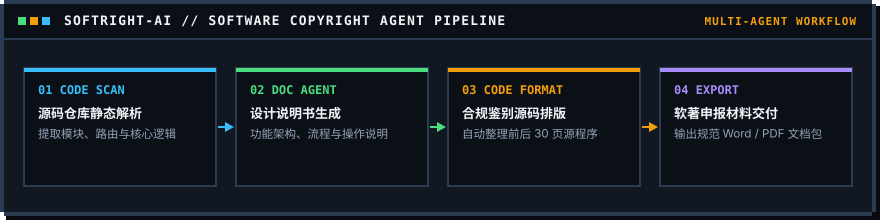
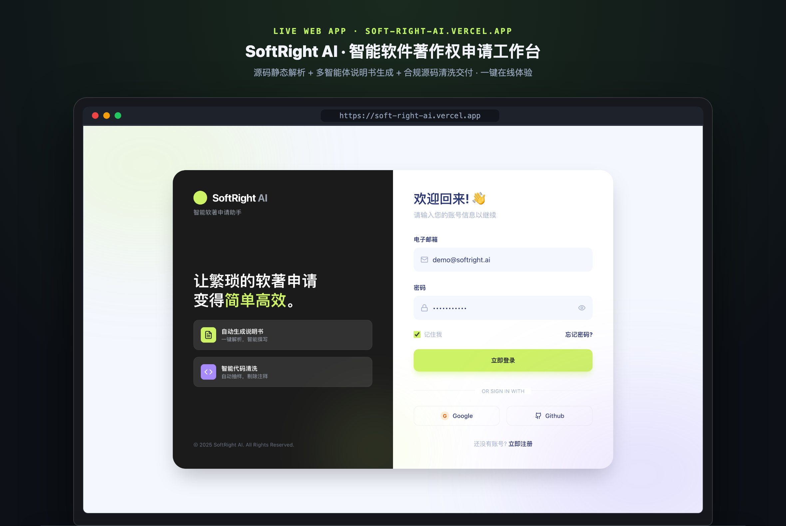

> **在线体验**：<https://soft-right-ai.vercel.app>

## **📖 项目简介**

**SoftRight AI** 是一个专为开发者和企业设计的智能体（Agent）系统，旨在解决软件著作权（软著）申请过程中繁琐的文档编写和代码整理痛点。

通过集成 **Google ADK (Agent Development Kit)**，本项目利用大语言模型自动分析项目源码，一键生成符合官方标准的《软件说明书》和《源代码文档》，并提供名称查重与合规性审查，将申请准备时间从 **3天** 缩短至 **10分钟**。

## **✨ 功能特性**

| 模块 | 功能描述 |
| :---- | :---- |
| 📝 **智能文书生成** | 基于源码自动提取功能点，生成包含软件结构、输入输出、运行环境的完整《软件说明书》。 |
| 🛡️ **代码合规清洗** | 自动遍历仓库，剔除空行与注释，按照“前30页+后30页”规则生成符合打印标准的 PDF。 |
| ⚖️ **风险合规审查** | 实时检测软件名称重复风险、开源协议传染性风险（GPL等）及文档一致性校验。 |
| 📊 **全流程可视化** | 仪表盘实时监控解析、生成、清洗、归档各环节状态，进度一目了然。 |
| 🤖 **多 Agent 协同** | DocAgent（文档）、CodeAgent（代码）、RiskAgent（风控）协同工作，确保专业度。 |

## **📸 UI 界面预览**

*请在此处替换为实际的项目截图，例如：仪表盘、文档生成页、代码编辑器*

| 仪表盘 (Dashboard) | 文档生成 (Docs) |
| :---- | :---- |
|  |  |

## **🛠️ 技术架构**

本项目采用前后端分离架构，核心 AI 能力由 Google Gemini 提供支持。

### **技术栈**

* **前端**: React 18, TypeScript, Tailwind CSS, Lucide Icons, Vite  
* **后端**: FastAPI, SQLAlchemy, Pydantic  
* **AI 核心**: Google ADK (Agent Development Kit), Gemini-1.5-Pro  
* **数据存储**: PostgreSQL (生产环境) / SQLite (开发环境)

### **Agent 协同架构**

graph TD  
    User\[用户 / 前端 UI\] \--\>|上传代码/文档| API\[FastAPI 网关\]  
    API \--\> Orchestrator\[Agent 编排器\]  
      
    subgraph "AI Agent Cluster (Google ADK)"  
        Orchestrator \--\> DocAgent\[📝 文档生成 Agent\]  
        Orchestrator \--\> CodeAgent\[💻 代码分析 Agent\]  
        Orchestrator \--\> RiskAgent\[⚖️ 风险审查 Agent\]  
          
        DocAgent \<--\> LLM\[Gemini Pro\]  
        CodeAgent \<--\> LLM  
        RiskAgent \<--\> LLM  
    end  
      
    DocAgent \--\> DB\[(数据库)\]  
    CodeAgent \--\> DB  
      
    DB \--\> User

## **📂 目录结构**

SoftRight-AI/  
├── frontend/                 \# React 前端工程  
│   ├── src/  
│   │   ├── components/       \# 核心组件 (UI Card, Buttons)  
│   │   ├── pages/            \# 页面视图 (Dashboard, Login)  
│   │   └── hooks/            \# 自定义 Hooks  
│   ├── tailwind.config.js    \# 样式配置  
│   └── package.json  
│  
├── backend/                  \# FastAPI 后端工程  
│   ├── app/  
│   │   ├── agents/           \# Google ADK 定义的 Agents  
│   │   ├── api/              \# REST API 路由  
│   │   ├── core/             \# 系统配置 (Env, Logging)  
│   │   └── services/         \# 业务逻辑 (PDF生成, 文件解析)  
│   ├── requirements.txt  
│   └── main.py  
│  
└── docker-compose.yml        \# 容器化部署配置

## **🚀 快速开始**

### **前置要求**

* Node.js \>= 16.0  
* Python \>= 3.9  
* Google Cloud API Key (用于 Gemini)

### **1\. 启动后端 (Backend)**

cd backend

\# 创建虚拟环境 (推荐)  
python \-m venv venv  
source venv/bin/activate  \# Windows: venv\\Scripts\\activate

\# 安装依赖  
pip install \-r requirements.txt

\# 配置环境变量  
cp .env.example .env  
\# 编辑 .env 文件，填入您的 GOOGLE\_API\_KEY

\# 启动服务  
uvicorn app.main:app \--reload \--host 0.0.0.0 \--port 8000

### **2\. 启动前端 (Frontend)**

cd frontend

\# 安装依赖  
npm install

\# 启动开发服务器  
npm start

访问浏览器：http://localhost:3000 即可开始使用。

## **🔌 API 文档**

后端启动后，可访问 Swagger UI 查看完整接口文档：http://localhost:8000/docs

| 模块 | 方法 | 端点 | 说明 |
| :---- | :---- | :---- | :---- |
| **Auth** | POST | /api/auth/login | 用户登录 |
| **Project** | POST | /api/projects | 创建新申请项目 |
| **Analysis** | POST | /api/analyze/repo | 连接 Git 仓库并进行初步分析 |
| **Generate** | POST | /api/generate/manual | 触发 Agent 生成软件说明书 |
| **Generate** | POST | /api/generate/code-pdf | 生成符合标准的源码 PDF |
| **Check** | GET | /api/compliance/report | 获取合规性检查报告 |

## **🤝 贡献指南**

我们非常欢迎社区贡献！如果您有好的建议或发现了 Bug：

1. Fork 本仓库  
2. 创建您的特性分支 (git checkout \-b feature/AmazingFeature)  
3. 提交您的修改 (git commit \-m 'Add some AmazingFeature')  
4. 推送到分支 (git push origin feature/AmazingFeature)  
5. 提交 Pull Request

## **📄 开源协议**

本项目基于 [MIT License](https://www.google.com/search?q=LICENSE) 开源。